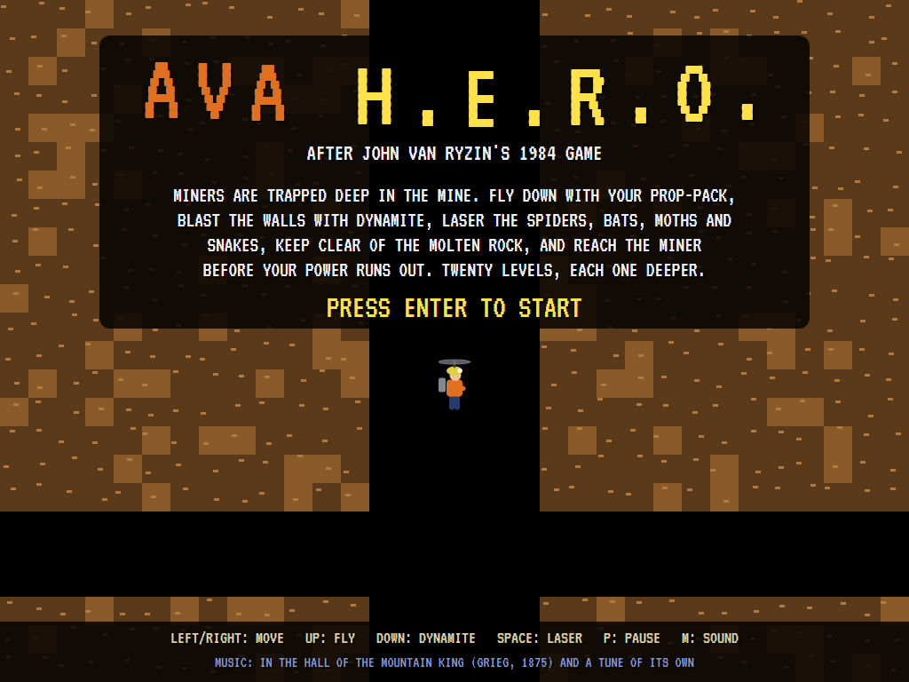
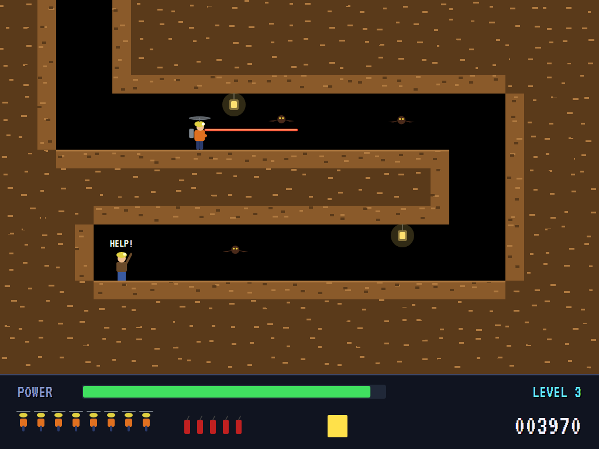
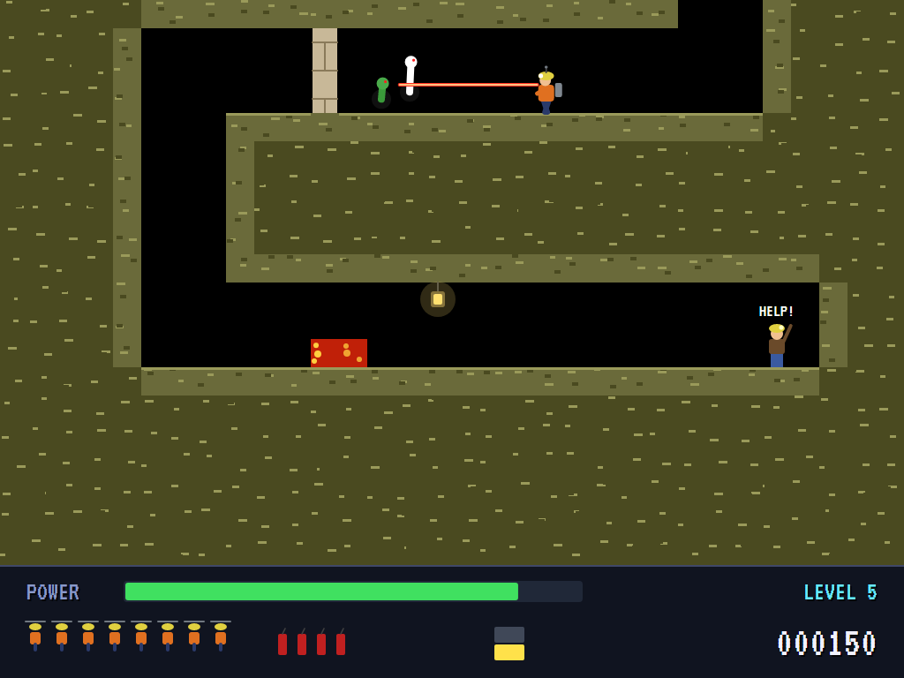
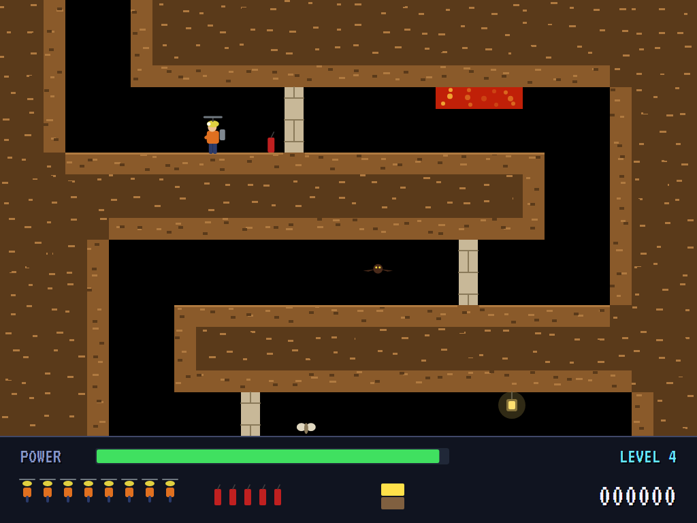
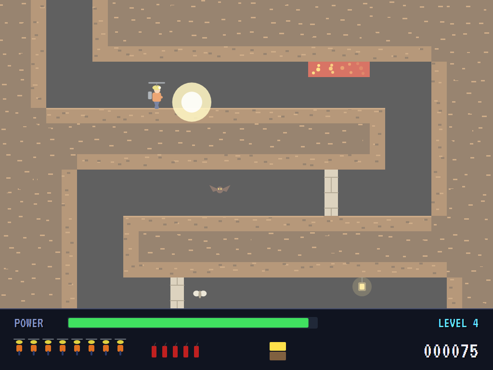
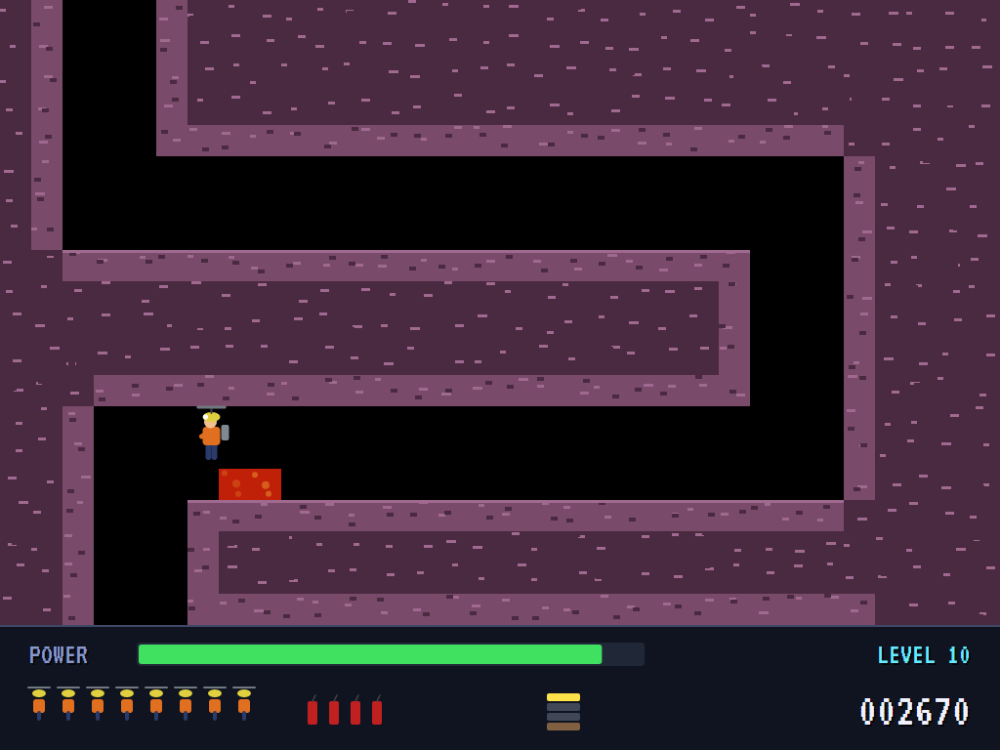
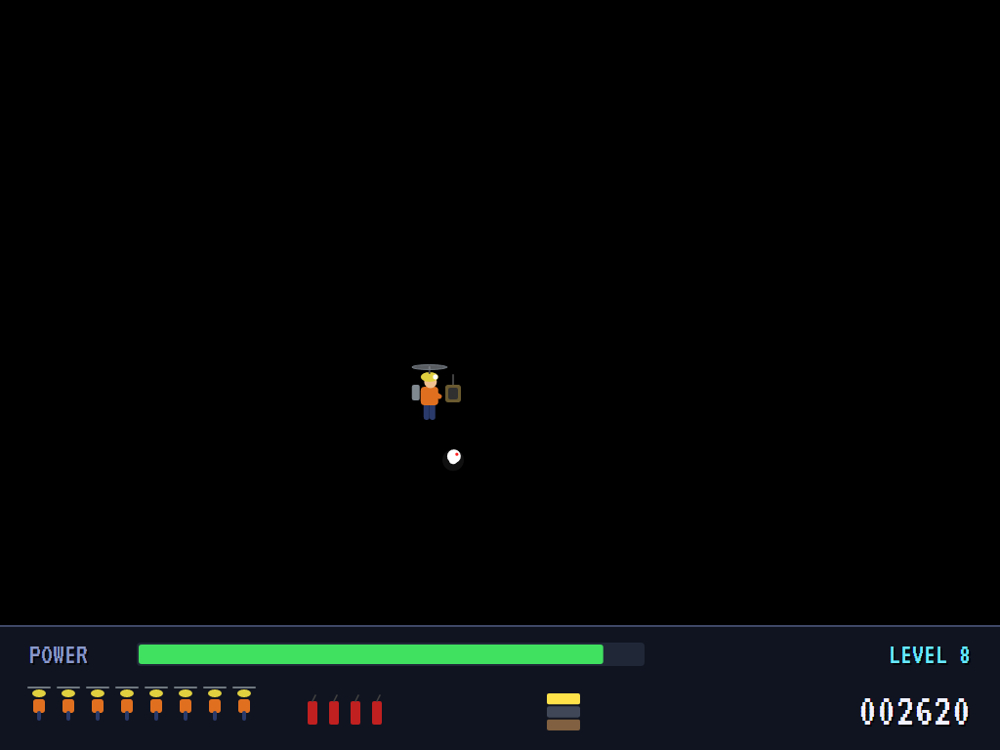
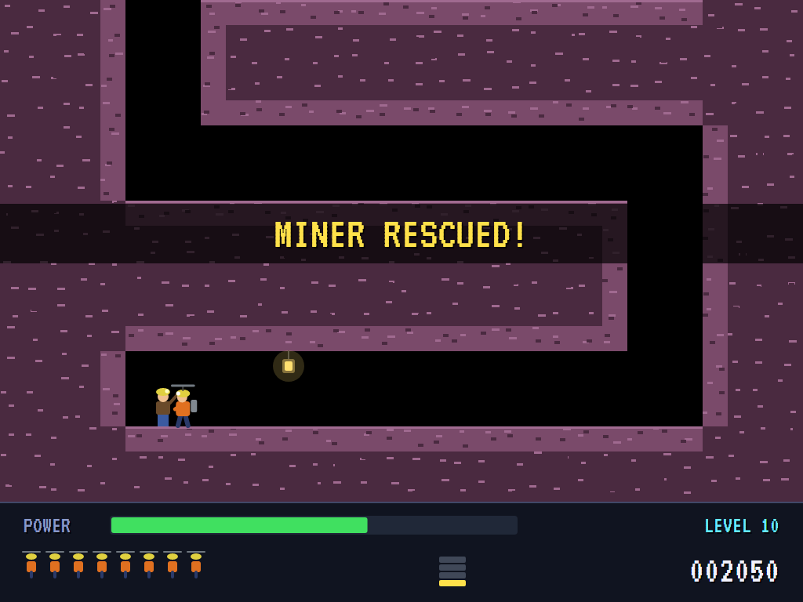
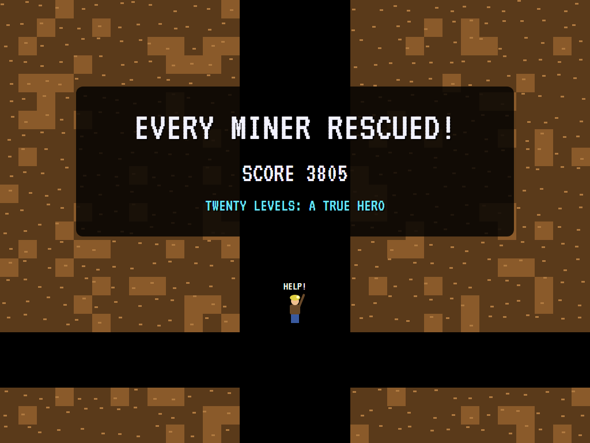

# AVA H.E.R.O.

[](https://github.com/Harlock123/AVAHero/actions/workflows/build.yml)

A mine rescue in the style of John Van Ryzin's 1984 Activision game **H.E.R.O.**, built with .NET 10 and
Avalonia UI. Miners are trapped deep in the mine. Fly down with your prop-pack and blast the walls with
dynamite. Laser the spiders, bats, moths and snakes, and keep clear of the molten rock. Reach the miner before
your power runs out.

## Features

- **Twenty levels**, each deeper than the last: from one screen of mine to seven. Each mine winds down from the
  top, a corridor across, a shaft down at the far end, a corridor back, to the miner at the bottom.
- **The prop-pack** takes a moment to spin up before it lifts, then lifts you against gravity; let go and you
  drop. Walk along the floors, or fly.
- **Dynamite:** six sticks a level. Set one down beside a wall and get clear before it goes: it blows the wall
  away, and anything close by, you included.
- **The helmet laser** fires ahead at eye height. It kills creatures at once and burns through a wall slowly,
  for when the dynamite's gone.
- **Dangers:** molten rock along floors and roofs, spiders on their threads, bats flying to and fro, moths
  fluttering, and snakes rising out of their holes. Knock a lantern and the lights go out on that screen.
- **Power** drains all the time. A new life brings it back up, starting at the beginning of the screen you
  were on.
- **Scoring:** 1,000 for each miner, 75 for a wall, 50 for a creature, then the power left (10 a second) and
  50 for each stick of dynamite not used. There's an extra life every 20,000.
- **The attract mode** shows the computer hero at work. It keeps a map of how far every place in the mine is
  from the miner, sized for its own body and kept clear of molten rock, with walls counted as slow going. Each
  moment it tries every pair of moves on a copy of the mine: left, right or neither, lifting or not, then
  again. It takes the first move of the pair that ends nearest the miner. The laser fires at anything in
  front. When the way is through a wall it sets down beside it, lights a stick of dynamite, backs off and
  waits; with no dynamite left it burns the wall down with the laser.

## Screenshots

| The title | Flying down | The laser |
|:---------:|:-----------:|:---------:|
|  |  |  |
| | The prop-pack lifting. | A snake and a moth ahead. |

| Dynamite | The blast | Molten rock |
|:--------:|:---------:|:-----------:|
|  |  |  |
| Set down by a wall, and away. | The wall goes. | Keep off the floor. |

| Lights out | Rescued | Every miner |
|:----------:|:-------:|:-----------:|
|  |  |  |
| A lantern knocked. | The power counted in. | |

The screenshots are made by the tests, which play the game in a real (headless) window; see
[Tests](#tests).

## Download and run

Ready-to-run builds for Windows, macOS and Linux, on both Intel/AMD and ARM, are on the
[Releases page](https://github.com/Harlock123/AVAHero/releases/tag/latest). **Latest build** is
rebuilt on every push to `main`. Each download is one self-contained executable: no .NET install is
needed.

| Platform | Archive |
|---|---|
| Windows | `AVAHero-win-x64.zip`, `AVAHero-win-x86.zip`, `AVAHero-win-arm64.zip` |
| macOS | `AVAHero-osx-arm64.tar.gz` (Apple silicon), `AVAHero-osx-x64.tar.gz` (Intel) |
| Linux | `AVAHero-linux-x64.tar.gz`, `AVAHero-linux-arm64.tar.gz`, `AVAHero-linux-arm.tar.gz` |

```bash
tar -xzf AVAHero-linux-x64.tar.gz     # or linux-arm64, linux-arm, osx-arm64, osx-x64
./AVAHero
```

On Windows, unzip and run `AVAHero.exe`. On macOS, if Gatekeeper refuses to open it, run
`xattr -d com.apple.quarantine AVAHero` once. Run with `--no-audio` for silence.

**Sound** comes through OpenAL Soft, built in for every platform. In a virtual machine the game
detects it and uses a larger audio buffer, so the sound doesn't break up.

**Gamepads** use SDL2, which is bundled for Windows, macOS and Intel/AMD Linux. ARM Linux builds need it
installed; without it the keyboard still works:

```bash
sudo apt install libsdl2-dev            # Debian / Ubuntu / Raspberry Pi OS
sudo pacman -S --needed sdl2-compat     # Arch / Omarchy
```

## Controls

| Action | Keyboard | Gamepad |
|---|---|---|
| Start | Enter or 1 | Start |
| Move | Left/right arrows, or A/D | Left stick / D-pad |
| Fly (the prop-pack) | Up or W | Up |
| Dynamite (on the ground) | Down or S | Down |
| Laser | Space, Ctrl, Z or X | A or B |
| Pause | P or Esc | Start |
| Sound on/off | M | |
| Screenshot | Ctrl+S (to your Pictures folder) | |

On the high-score table, type your initials, or use up/down and Space, then Enter.

## Tests

```bash
dotnet test AVAHero.slnx
```

The game runs in fixed 60 Hz steps, so it plays the same at any frame rate. Everything that changes lives in
one world that can be copied, mine and all; the creatures go by the clock. The tests check:

- **The mines:** the same from the same seed, deeper level by level; every one starting in the open with the
  miner on the floor at the bottom; no molten rock where the hero must set down by a wall.
- **Flying:** walking, falling, and the prop-pack lifting only once it has spun up; rock stopping him, and the
  roof holding him down; down a shaft to the miner and the rescue.
- **Dangers:** molten rock; a creature deadly to touch, and the laser killing it; the power running out, and a
  new life back at the screen's start with full power; a lantern putting the lights out.
- **Walls:** dynamite blowing a wall away, and the hero with it if he stays; the laser burning through slowly;
  dynamite only on the ground, one stick at a time.
- **The game:** a rescue counting in the power and dynamite left, then the next level; lives running out, and
  initials; the demonstration and high scores; pause; a copied world; the keys.
- **The computer hero:** the miner rescued on levels 1, 4 and 8; just flying about and firing rescues no one.

`tests/AVAHero.Tests/PilotProbe.cs` reports how the computer hero gets on, level by level, for tuning
(`HERO_PROBE=1`). It rescues all twenty miners, losing six lives along the way, mostly to bats.
`HERO_PROBE=lazy` flies to and fro firing and rescues no one.

The screenshot tests draw the real screen in a headless window. To refresh the README's pictures:

```bash
HERO_SHOTS=$PWD/Images dotnet test tests/AVAHero.Tests --filter ScreenshotTests
```

## Building

```bash
dotnet build AVAHero.slnx
dotnet run --project src/AVAHero
```

Needs the .NET 10 SDK. The sounds, music and voice are made by `tools/make_sounds.py` (standard-library
Python, with the formant voice in `tools/speech.py`): `python3 tools/make_sounds.py` rewrites
`src/AVAHero/Sounds`.

## Project structure

```
AVAHero/
├── AVAHero.slnx
├── src/AVAHero/
│   ├── Engine/
│   │   ├── GameEngine.cs        # States, levels, lives, the rescue tally, the demonstration
│   │   ├── Sim.cs               # The hero step by step: flying, rock, the laser, dynamite, creatures, power
│   │   ├── Mine.cs              # The twenty mines, built from seeds
│   │   ├── World.cs             # Everything that changes, kept together so it can be copied
│   │   ├── Pilot.cs             # The computer hero (the demonstration, and the tests)
│   │   ├── HighScoreTable.cs, InitialsEntry.cs
│   │   ├── InputHandler.cs, ControllerManager.cs  # Keys and an SDL2 gamepad
│   │   └── SoundManager.cs      # Effects, music and voice through OpenAL
│   ├── Audio/                   # The OpenAL engine (from the author's AVABand)
│   ├── Views/GameCanvas*.cs     # The mine, the hero and creatures, the panel, the title
│   └── Sounds/                  # The synthesised effects, music and voice
├── tests/AVAHero.Tests/         # Gameplay and screenshot tests
├── tools/make_sounds.py, tools/speech.py
└── Images/                      # Screenshots
```

## About and licence

AVA H.E.R.O. © 2026 Lonnie Watson, under the [MIT License](LICENSE).

*H.E.R.O.* © 1984 Activision (designed and programmed by John Van Ryzin); the name *H.E.R.O.* belongs to its
current owner. AVA H.E.R.O. is an independent, unofficial game in its style. Its mines, graphics, sounds and
code are its own; nothing is taken from the original game's program, graphics or sound. It is not affiliated
with or endorsed by any rights holder. In the Hall of the Mountain King (Grieg, 1875) is in the public domain,
arranged here from scratch.
